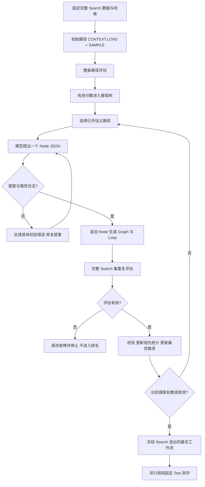
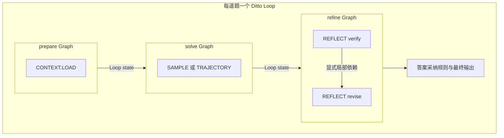
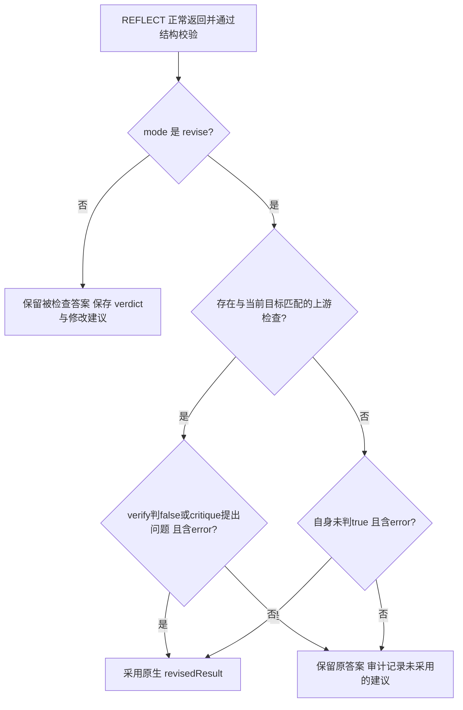

**节点调度体系与本次修改报告（2026-10-20）**

范围：DROP / GSM8K 工作流搜索，Ditto npm 固定版本 0.1.1；新应用协议 `mflow-fixed-flash-v5`、格式适配 `reflect-format-v2`、checker 行为 `checker-semantics-v1`。原实验冻结提交为 `dac1fb9e6926fdbdb5794e1794a466fc3e96cd0d`。本文区分历史行为与本次实现；本地其他未提交的 AutomationBench 工作不在本次提交范围。

当前方法搜索的是“追加一个真实 Ditto Node 的构造路径及其局部依赖”。应用把路径分成固定阶段的 Graph，再生成默认线性 Loop。优化器不能直接生成任意 Graph/Loop 程序、TypeScript 或 npm 内部代码。运行时支持条件与重复，并不表示当前搜索器正在搜索这些控制结构。

**1. 五个层次及三个不同的“候选”**

| 层次 | 对象 | 职责 |
| --- | --- | --- |
| 搜索 | SearchTreeNode / NodeWorkflowSearch | 选择已评估父路径，增加一个节点，评估整个新路径 |
| 阶段 | ExecutionGraph | 对同一阶段的节点按局部 DAG 依赖调度 |
| 工作流 | 一个 Ditto Loop | 运行 Graph、保存跨阶段状态、执行显式 transition、返回答案 |
| 执行 | ContextWorker / InferWorker | 按节点类型检查输入、运行原生处理函数并返回 NodeResult |
| 推理 | SAMPLE / Provider / Python SDK | 序列化消息、调用模型、流式接收、保存 finishReason/usage/故障证据 |

“工作流候选”是一整条可执行节点路径；“节点提案”是优化器新提出的一个 Node；“答案候选”是 DELIBERATE 或 TRAJECTORY 内部比较的若干题目答案。三个对象的数量和分数不能混用。



**2. 初始候选如何产生**

`search-000` 固定为 `CONTEXT.LOAD`，不能单独回答题目，不进行模型评估。`search-001` 增加固定的 `sample-1`，形成第一个完整候选；没有先让优化器自由生成初始工作流。

```text
search-000: CONTEXT.LOAD
  └─ search-001: SAMPLE(sample-1)
       ├─ search-002: 可能增加 verify
       │    └─ search-004: 可能增加 revise
       └─ search-003: 可能直接增加 revise
```

图中的搜索父子关系表示“由哪条构造路径扩展而来”，不等于执行依赖。两个兄弟候选分别执行，不会互相传递答案。每个搜索树条目存一个真实 Node；从根追溯到该条目的路径才是一份完整候选工作流。

DROP/GSM8K 的初始 SAMPLE 使用固定 MFlow agent seed 和 root message profile，按原文组装为一条 user message。初始路径在日志中叫 baseline，但它是本方法的单次生成起点，不是重新执行完整 MFlow 多代理方法。首轮每题一次模型调用；Context 加载不调用模型。

**3. 后续候选如何提出与选择**

优化器本身运行一个固定 proposal Graph，里面只有一个 `INFER.REASONING.SAMPLE`。该模型看到：任务目标、当前路径、各 Graph 可依赖节点 ID、固定 checker contract、最近的有限经验与提案校验错误。公开的 MFlow review / integrate seeds 是可编辑参考，不会自动变成 REFLECT 原生 system prompt。私有 gold、GSM8K cot 和评分异常文本不发送给优化器。

模型每次只能返回一个允许的 Node JSON。可信应用分配 ID，进行提案/路径/语义校验，按规范化 JSON 计算路径 SHA-256 并拒绝重复路径。合法提案才会生成新候选。不是只评估新增节点：每次要从 prepare 开始执行整条新路径；符合恢复身份的已付费成功案例另有受控恢复机制。

已有父路径中的节点不会被提案原地改写、删除或重连。mode、criteria、instruction和局部依赖的搜索只作用于本次新追加节点；重新选父路径可以走另一分支，但不等于修改旧节点。这也是优化器不能自动重写祖先checker的冲突criteria或原生解析器的原因。当前修复由应用代码明确完成，不能称为优化器自行学会了修改节点内部实现。

当前选择器从已直接评估且深度允许继续扩展的工作流中取最高分的 Top-K（默认 K=4），然后随机选父路径。设 `s_i=100×score_i`，概率为：

```text
w_i = exp(0.2 × (s_i - max(s)))
p_i = 0.3 / K + 0.7 × w_i / sum(w)
```

随机种子控制本地父路径选择，模型请求不发送 seed。它不是固定二叉树，也不是标准 UCT 选择公式。每次只追加一个节点，每个父路径可以扩展出多个孩子。

有效评估完成后，叶子保存直接分数，沿搜索父链累加 visits、scoreSum、meanScore、bestScore、tokens、latency。该“回传”更新搜索统计，不训练模型参数。最优工作流按直接评估均分选取，同分优先较早轮次；不能把祖先聚合分当成其直接测评结果。

默认执行初始评估后最多20次成功扩展评估；无效提案不消耗已完成评估轮数。收敛条件是历史 Top-3 均分在连续5次转移中不变（z=0）。这与每候选重复评估5次是两件事。

**4. Graph 与 Loop 的实际调度**



Graph 使用 ready queue 和依赖计数：依赖已完成的节点进入就绪队列；无依赖的同阶段节点可并发；节点完成后释放其依赖者。数组中写在前面不构成执行边。Graph 中只能读取明确声明的局部依赖输出，不能偷读并行兄弟输出。

Loop 每次提交一个 Graph，等待该 Graph 返回，保存所有阶段输出、执行历史、访问次数、用量和审计，再判断下一阶段。跨 Graph 的数据由 `priorOutputs` 状态传递，所以第一个 refine 节点通常 `dependencies: []`，仍能读取 solve 答案；不应伪造跨 Graph DAG 边。

| transition | 代码行为 | 当前默认搜索是否自动生成 |
| --- | --- | --- |
| next | 进入指定 Graph | 是，prepare→solve→refine |
| end | 结束工作流 | 是，最后阶段结束 |
| repeat | 看 until 条件及 maxVisits，重复同一 Graph 或转下一阶段 | 通用运行时支持，当前提案不生成此字段 |
| switch | 按条件选 Graph，或走 default | 通用运行时支持，当前提案不生成此字段 |

条件读取指定节点输出路径，操作符有 equals / not-equals / truthy / falsy。`passed=false` 本身没有自动循环语义。新代码的答案保留规则也不是暗中修改 Loop transition。

API thinking=disabled 不等于禁止应用采用 cot 策略或请求公开解题文字。Trajectory/Loop 的执行上限使用 `Number.MAX_SAFE_INTEGER`，没有额外整题 token 总预算；有限策略参数、搜索路径长度、单次输出上限、传输超时仍存在，不能把它理解为所有层面都无限制。

**5. 各类 Node 及内部细分操作**

| Node | 输入 | 内部操作与输出 | 正常模型调用数量 |
| --- | --- | --- | --- |
| CONTEXT.LOAD | 公开题目、允许的元数据 | 加载/规范化 Context；不带 gold | 0 |
| SAMPLE | model、generation、messages | 校验输入→provider→校验消息，返回 message / finishReason / usage | 1 |
| TRAJECTORY | objective、历史消息、strategy、options | 运行内置策略，记录 model / decision / final steps，输出 result / steps / status / stopReason | 依策略变化 |
| REFLECT | 原题、target、mode、criteria、context | 一次内部 SAMPLE→解析 JSON→原生 schema→应用权限/采纳规则→审计 | 通常1；格式修复可增加 |
| DELIBERATE | 原题、多个答案候选、mode | 一次内部 SAMPLE 比较候选→解析/校验结构→选择或整合答案 | 通常1 |

REFLECT 的三个模式是 critique（提出问题）、verify（给 passed）、revise（提供 revisedResult）。新应用层让前两个模式只检查，保留它们实际检查的原答案；原生节点仍可能返回 revisedResult，该建议被保存在审计中。

DELIBERATE 的四个模式是 select / merge / consensus / debate。select 的最终答案取被选 ID 对应的原候选，不盲用模型另外编写的 result；另外三个模式采用合成的 result。它比较的是题目答案，不是搜索器的全部工作流树，也不是调用 benchmark gold 的评分器。

| TRAJECTORY 策略 | 实际内部细分 | 本仓库允许搜索的参数 |
| --- | --- | --- |
| cot / long-cot | 串行 SAMPLE，每一步将公开中间结果传给下一步 | rounds 1..8 |
| tot | 每层扩展分支→内部 DELIBERATE select→保留 beam→进入下一层 | breadth、depth、beamWidth 各1..4 |
| got | 每层产生互补分支→内部 DELIBERATE merge→共享结果进入下一层 | breadth、depth 各1..4 |
| self-consistency | 多次独立 SAMPLE 返回 solutionSummary/answer→规范化最终答案→确定性投票 | candidates 2..7；最高票平局报 NO_CONSENSUS |

TRAJECTORY 的这些 SAMPLE/DELIBERATE 是原生处理函数内部调用，不会各自新增搜索树条目或工作流 Graph 节点；独立分支在当前内置策略里按循环依次发起，不能仅凭“分支”一词断定并发。

如果“二分节点”指二叉结构，代码没有强制二叉结构。如果指 checker 的二态判定，passed 是布尔字段，但应用决定是否采用修改还需要 mode、issues 和目标对应关系。具体判定如下。



这里的 error 至少要求明确的 error 严重度与非空描述；代码不能证明描述中的数学判断是真的。具体依据仍需模型正确判断。critique 允许没有 passed；verify 必须有布尔 passed。即使门控最终保留原答案，计划中的 revise 当前仍会真实执行、消耗仍计入，没有合成零调用的模型响应。

**6. 上下游传递的具体内容**

旧 DROP search-004 的 verify 与 revise 都没有局部依赖，因此它们可以并行检查 solver；revise 看不到 verify 的意见。只添加依赖也不够，旧绑定只抽取 message/result/revisedResult，不传 assessment/issues。

新规则：同一 refine 中已有 verify/critique 时，后续 revise 必须显式依赖最近的 checker。运行时同时传递：

```json
{
  "target": {"result": {"role": "assistant", "content": "原答案"}},
  "context": [{
    "id": "checker-feedback:revision",
    "content": {
      "originalAnswerNodeId": "sample-1",
      "originalAnswer": {"role": "assistant", "content": "原答案"},
      "checks": [{
        "nodeId": "checker",
        "assessment": {"passed": false, "summary": "检查结论"},
        "issues": [{"severity": "error", "description": "具体问题", "suggestedFix": "修改依据"}]
      }]
    }
  }]
}
```

只有目标来源 ID 和原答案文本都匹配的检查意见才会被传给 revise，避免旧意见误作用到更新后的答案。verify 的建议答案不冒充已经确认的原答案。最终保存 `checkerAudits`：原答案、原始 verdict/issues、模型建议、采用结果、依赖 checker ID、采用原因与 criteria。评分器只读取最终答案；这些公开模型审计不向优化器泄露 gold。

**7. 模型调用链与参数**

```text
Loop.graphStep
  → Graph依赖调度
  → Worker.execute(NodeType, boundInput)
  → Node原生输入校验与处理函数
  → 内部 SAMPLE
  → budget provider边界 → REFLECT格式适配
  → 并发限制与固定模型参数
  → Ditto HTTP provider
  → PythonTransport（JSONL子进程通道）
  → provider_bridge.py / OpenAI Python SDK
  → DeepSeek官方API（stream）
  → 消息/finishReason/usage → 原生输出校验 → 应用采纳 → evaluator
```

统一 `deepseek-flash`、官方 endpoint、temperature=0、thinking disabled、max_tokens=393216、n=1、response_format=text、stream=true；不传 top_p、reasoning_effort、模型 seed。模型参数在应用与 HTTP 序列化处约束。max_tokens 是请求上限，不能保证供应商实际生成相同长度。当前 text 模式下 JSON 由提示词和校验维持，没有供应商 JSON schema 保证。

任务并发、Graph 节点并发、provider 请求并发是不同层次，provider 队列控制实际同时发出的请求。日志的一个逻辑调用又可能包含 SDK HTTP 重试；不能把一个 Graph Node 等同于一个 HTTP attempt。

连接超时5秒、读取超时600秒；SDK最多3次 HTTP 尝试；工作流最多5次、仅对瞬时故障重试。认证/余额等错误不通过整工作流反复重试。REFLECT 格式最多3份响应，但无法建立安全语义锚点时立即拒绝，不拿未知内容重新自由判题。

**8. 提示词内容与优先级**

完整原文见配套文件 `node-prompts-v5.zh-CN.md`，由固定源字符串及离线捕获的真实组装消息生成，没有调用模型。提示词分成五处，不能把它们当成同一份：

1. MFlow 初始 agent seed + root profile：初始 SAMPLE 的 user message；本次保持字节合同。
2. 搜索器 system prompt：要求返回一个 allowlist Node JSON；user JSON 提供当前路径、经验和 checkerContract。
3. Ditto 原生 REFLECT / DELIBERATE system prompt：npm 内固定；本次没有修改 npm 文件。
4. 应用 checker contract + 搜索生成的 criteria：放进 REFLECT 的 criteria；前者固定，后者可搜索。
5. 格式修复消息：仅对可保持语义的结构失败追加；保留历史、编号，并在代码中比较实质字段。

新固定 contract 的含义是：DROP 允许原文依据上的计算，计算答案不必原文逐字出现；GSM8K 检查本题单位和计算，另一个假设解释不等于原答案错误；没有明确错误时允许 passed=true、issues=[]；建议/歧义与 correctness error 分开；只有 revise 可提出替换，不能为了迎合批评强改原答案。

这里的自然语言约束不是可形式化证明的判断器。代码另外拒绝已知冲突用语并执行答案权限，不能据此宣称模型已经没有误检或漏检。

**9. 合法性校验准则**

| 边界 | 校验内容 | 失败处理 |
| --- | --- | --- |
| 数据 | 固定 MFlow 原始字节 SHA-256、条数、顺序、任务 ID；正式 limit必须0 | 不启动正式评估 |
| 提案 JSON | 只能一个对象；type/graphId/config字段白名单；不接收代码、provider、密钥、整workflow或Node数组 | 最多3次提案修复；持续无效停止 |
| 节点 | ID唯一且符合规则；合法模式与阶段；instruction长度；criteria 1..8项；固定generation；策略键和值域 | 不加入可评估候选 |
| 路径 | 根为唯一CONTEXT.LOAD；prepare→solve→refine顺序；路径1..24节点；已有答案生产者；依赖仅指向同Graph较早节点且不重复 | 拒绝路径 |
| 新checker语义 | DROP已知计算冲突用语拒绝；revise必须依赖同Graph最近checker | 在模型执行前拒绝 |
| 计划/Graph | 每Node仅归属一个Graph；入口/输出/transition目标存在；局部依赖拓扑正确 | 不运行该计划 |
| 原生输入 | model/messages、REFLECT target/criteria、DELIBERATE candidates/IDs、strategy等类型和模式合法 | NodeResult失败 |
| 原生输出 | 消息结构、REFLECT布尔passed/顶层issues/revisedResult、DELIBERATE候选ID数量与归属 | 格式适配或工程故障 |
| 答案采纳 | verify/critique保留目标；revise按匹配检查意见与error门控；保留所有审计 | 不把建议当最终答案 |
| 评分 | 有限数值且在[0,1]；完整重复成员均有效；gold只在私有评分闭包 | 无效评估不能进入排名/经验/回传 |
| 恢复/最终Test | 源码/依赖/协议/模型/提示词/metric/数据/有序成员/repeats身份一致 | 拒绝混用不同版本结果 |

DROP 冲突文本检查只是覆盖已经见到的英语规则模式，并非能理解任意自然语言标准的静态分析器。节点的结构合法与解题正确性是两层校验；JSON 合法、passed=true 都不能替代 benchmark 分数。

具体约束还有：Node ID 为 `[a-z][a-z0-9-]{0,63}`；非初始SAMPLE的instruction非空且最多4000字符，初始sample-1允许空instruction；提案criteria/dependencies每项最多1000字符，criteria 1..8项，提案dependencies 0..8项且不重复；DELIBERATE要求至少两个本地solver候选依赖。通用节点schema接受temperature在[0,2]、maxTokens在[64,393216]，但正式提案额外要求精确等于temperature=0/maxTokens=393216，provider发出请求时再次固定参数。不能把通用schema的取值范围误认为实验实际使用的取值。

**10. 候选如何评估**

正式 Search：DROP 200题×5次=1000次执行；GSM8K 264题×5次=1320次执行。五次是同一个完整集合的重复评估，不是分层抽样、五折或划分五份。Test 分别800/1055题，由冻结最优工作流另行执行；默认Test repeats=3，不反向选择工作流。

若不计优化器、格式与HTTP重试，一条 SAMPLE+verify+revise 路径每题三次模型调用，DROP一候选约3000次、GSM8K约3960次；这与单次响应n=1不冲突。原生TRAJECTORY可让一次Node执行内产生更多模型调用。

DROP 使用与固定 MFlow 对齐的最大 token F1（含 pipe 分段的既有规则），不是原生 DROP 的多span匹配实现；GSM8K 使用最后数值提取与1e-6容差。没有 LLM judge。正常错误答案得0、部分DROP答案得连续分数；checker判false不会直接被计为答案错误。

HTTP/执行/未解决格式/评分故障令候选评估无效。结果文件中的0只是占位，不应解释为模型正确率0。正常finishReason=length保留真实原因：可用结构进入评分，不可用截断输出按既有策略给空答案评分；不自动再生成，也不回退继承此前正确答案。其他异常不走这个长度策略。

有效结果才更新搜索、产生经验、参与Top-K选择。经验中只有公开Node、分数/差值、有限预测案例等；本地私有expected与评分错误不进入优化器。

v5的纯verify路径对同次被检查答案不作改写；它与另一个候选的平均分不同，仍可能来自重新生成solver答案等因素，不能直接解释为verify纠错增益。因此本文用同次目标答案配对追踪修改，而不以不同轮次的平均分差代替因果验证。

**11. 本次工程缺陷修改清单**

| 缺陷 | 根因 | 已实现处理 |
| --- | --- | --- |
| verify可覆盖答案 | 执行器把可选revisedResult直接当最终message，权限未区分mode | verify/critique的有效message固定为实际target，建议完整记审计 |
| checker意见没有传给revise | 依赖绑定只提取答案message，不提取assessment/issues | 分开绑定原答案、来源ID、结构化检查意见 |
| 并行检查被误当串行纠正 | 提案和路径校验允许已有checker后的revise仍无依赖 | 路径和执行前强制显式依赖最近checker；新提案说明同阶段边 |
| 修复请求重复 | 旧适配每次从原消息重建，丢掉更早反馈 | v4已累计历史与编号，本次保留 |
| 结构错误阻断正确内容 | 模型产生错层issues、多余括号、非法转义，适配缺少确定性修复 | v4已增加归一化、原文审计与原生schema终检，本次保留 |
| 格式重试可能偷改语义 | 单靠“只改格式”提示不足以约束新响应 | v4已对语义锚点严格比较，禁止翻转判定/删issues/改答案 |
| 无法追踪实际采用了什么 | 最终预测不能完整解释checker如何影响答案 | 本次记录并随CaseResult保存checkerAudits，区分提议和实际采用 |
| 修改后混用历史结果风险 | 相同旧计划在新语义下可能产生不同最终答案 | 本次协议升级v5；旧文件不重标、不原地恢复；回放显式克隆迁移 |

此前PR中故障隔离、优化器gold泄露修复与length边界处理属于已经合入的历史修复，本文不把它们冒充本轮新增成果。

**12. 节点与任务层问题、证据及仍然存在的限制**

| 问题 | 已核查证据 | 本次处理及限制 |
| --- | --- | --- |
| DROP标准误伤计算 | 4656答案1被改为10-9；3023答案10.7%被改为无法确定 | 固定计算规则、拒绝已知冲突criteria、verify权限分离；自然语言检查质量仍需新模型实验 |
| 合理解释被过度质疑 | GSM8K37次正确数值被判false，涉及14题 | 允许空issues、区分歧义/建议/error；不把37次全称为已证明的误报 |
| 检查意见会改坏答案 | 旧1309次合法GSM8K执行中12次对→错、1次错→对 | 分离verify/revise；停止verify越权也会失去那1次原本有益修改 |
| 同模型会漏检 | 371的100相对gold50错误；984的168相对gold342错误 | 没有偷偷按gold改checker；新代码不保证语义识别准确 |
| JSON本身有歧义 | 完整回放又发现4条顶层issues与assessment.issues不同 | 延续v4严格拒绝，不选一个版本猜测；这些工程故障仍会阻止完整候选被视为有效 |
| 原生节点可修改范围有限 | 优化器只能输出允许的Node配置 | 本次修改应用适配、proposer约束与权限；npm内部system/schema未改 |

离线回放位于 `runs/parallel-drop-gsm8k-20261019-1ded01d7/analysis/checker-semantics-replay-2026-10-19T17-14-51-247Z-18648/`：

- 完整GSM8K Search集合264题×5次，1320条保存响应回放：1316条完成，4条拒绝；不能因此发布正式完整正确率。
- 37次原“正确target/false首判”涉及的回放全部保留正确原答案；程序没有把旧false伪造为true。
- 阻止旧12次正确→错误的答案覆盖；同时失去旧1次错误→正确的越权覆盖，体现权限收紧的代价。
- 旧12次停止案例全部进入真实私有评分器，其中9次得满分、3次错误仍得0。与v4的8次满分相比，527的48不会再被verify改成24。
- DROP4656、3023复用旧响应后，最终保留原答案，两个案例均由旧0分变为1分。这是代码权限效果，不证明新提示词已经改变模型判断。
- 4条拒绝：`gsm8k-test-629#1`、`gsm8k-test-984#2`、`gsm8k-test-984#3`、`gsm8k-test-1303#5`，全部为顶层/嵌套issues冲突。逐条原文、请求ID、用量与结果保存在回放文件。

完整代码检查在隔离源码快照执行，类型检查与124/124项测试通过。回放没有新增模型调用，没有读取保留Test；所用完整原始数据先校验固定哈希，诊断迁移只写新目录，原证据哈希未变。部分记录回放使用该次历史最终合法checker响应，旧格式失败记录使用首条可确定归一化的原始响应；这不是对新提示词采样结果的测量。

18例新提示词真实API诊断尚未启动，正式搜索也未重启。因此当前完成的是工程与保存响应下的行为验证，不能宣称模型误报率已经降低，或新版本正式准确率已提高。

**代码定位**

搜索：`src/search/optimizer.ts`、`proposer.ts`、`selector.ts`、`backprop.ts`、`convergence.ts`；构造与运行：`src/workflow/spec.ts`、`executor.ts`；本次checker约束：`src/workflow/checker-policy.ts`、`checker-semantics.ts`；初始提示词：`src/benchmark/baseline-prompts.ts`；模型通道：`src/ditto/runtime.ts`、`python-transport.ts`、`scripts/provider_bridge.py`；评分：`src/benchmark/evaluator.ts`及各dataset adapter；重放：`scripts/replay_checker_semantics.mjs`。

此前逐样本审计见 `checker-node-audit-2026-10-20.zh-CN.md`；完整提示词原文见 `node-prompts-v5.zh-CN.md`。
